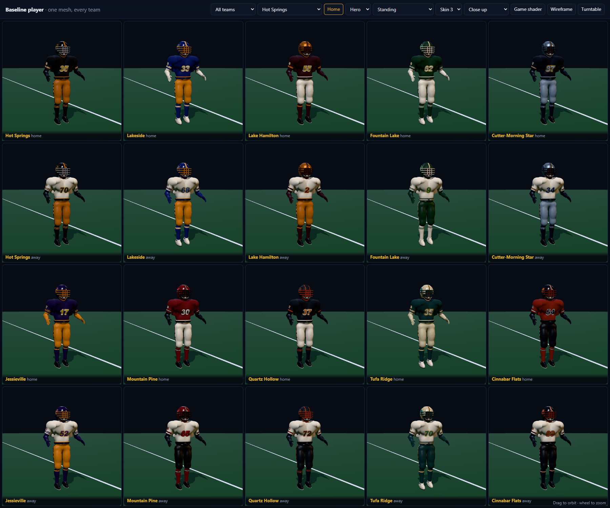
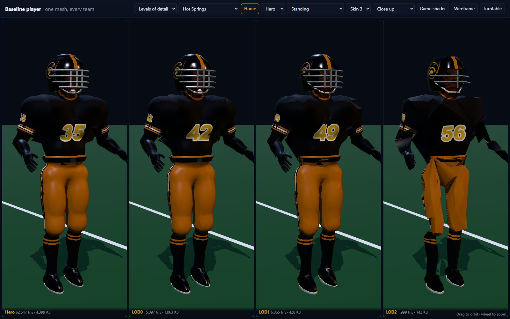
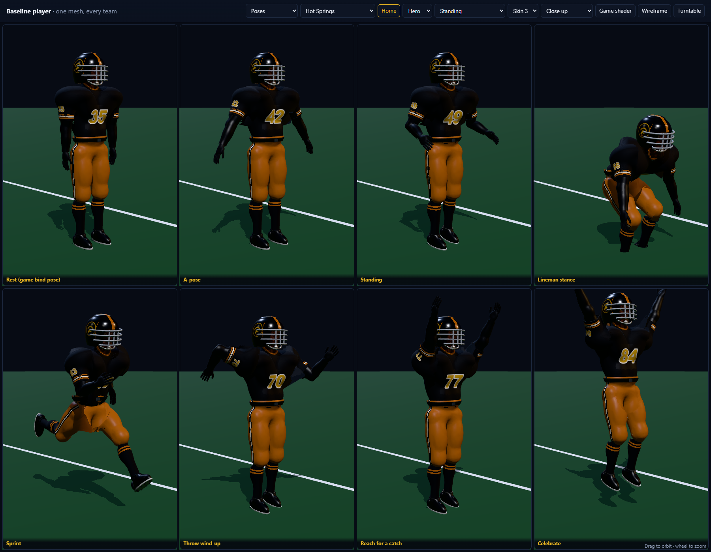

# Baseline player

A new, original player model for Friday Night Spa City. It's realistic enough for close-up replays and dressed in its own designed uniform for each of the game's 10 teams, home and away. It is built in Blender from scratch with one reproducible script, ships at four levels of detail, and is a drop-in for the game's player pipeline:

- the same 11-bone skeleton and arms-down rest pose;
- the same pack encoding;
- driven by the game's own `Rig.pose()`.



## Reference and originality

The quality target is a commercial model the user picked: [American Football Player by Trish on RenderHub](https://www.renderhub.com/trish/american-football-player-1). It's a $60 asset with 54,515 polygons and 56,384 vertices, photo-textured. **It was not bought, downloaded or traced, and its preview images were never loaded into Blender.** Only its public previews were looked at, for three things:

- the realism level;
- an athletic build;
- generic kit construction: a jersey over shoulder pads, long compression undersleeves, pants with side stripes and knee bulges, banded socks, laced low cleats, and a striped helmet with a 4-bar mask.

Everything here is modelled from scratch: the body, the face, the garments and the hard surfaces. Its sculpt, face, chest emblem, helmet graphics and textures are not reproduced.

The team graphics are new designs (`src/js/kits.js`). The helmet badge is the game's own geometric mascot art (`src/js/art.js`). That follows the project rules: real schools are setting only, there are no logos, and players are fictional.

## Levels of detail

| | Triangles | Target | Pack JSON | Parts | What changes |
|---|---:|---:|---:|---:|---|
| **Hero** | 62,547 | 60k | 4,399 KB (GLB 2,065 KB) | 108 | Everything: cloth folds, laces, studs, mask struts, clips and welds, eyes with lids and brows, five-finger hands |
| **LOD0** | 15,097 | 15k | 1,063 KB | 106 | Same parts as the hero, decimated, without folds |
| **LOD1** | 6,065 | 6k | 428 KB | 45 | Drops laces, studs, mask struts, clips, welds and the chin cup |
| **LOD2** | 1,999 | 2k | 142 KB | 22 | Mitten hands, a 2-bar mask, no eyes or hems |

- **Where the hero's triangles go:**
  - jersey 11.5k, pants 8.5k, head and face 6.5k, helmet shell 5.9k;
  - undersleeves 3.6k, mask bars and uprights 4.4k;
  - hands 5.1k, socks 2.4k, cleats about 5k;
  - the rest is trim.
- **Triangle counts** are measured through the game's own decoder (`compat.test.mjs`).
- **The pack fits:** LOD0 to LOD2 together are 1.6 MB; with the HD official the players pack is 2,085 KB of its 3,584 KB budget.
- **The hero does not fit** (4.4 MB). It's for the showroom and replays, and would need on-demand loading in the game.



**Pixel check.** This uses the method from `experiments/lod-showcase`. Each level is rendered at the size it really gets on a 1080p screen through the game's 40° camera. It is then compared with a 16×-supersampled hero. The table shows the share of the player's pixels that differ visibly. The hero column is pure aliasing, and no level can beat it.

| Distance | Hero (floor) | LOD0 | LOD1 | LOD2 |
|---|---:|---:|---:|---:|
| 3 m | 5.6 % | 11.1 % | 19.7 % | 41.5 % |
| 8 m | 9.1 % | 12.3 % | 19.6 % | 39.6 % |
| 20 m | 15.5 % | 17.9 % | 22.9 % | 40.4 % |
| 45 m | 26.2 % | 27.3 % | 28.6 % | 45.1 % |

- **LOD0** is within 3 points of the floor from 8 m out.
- **LOD1** is within 2.5 points at 45 m.
- **LOD2** stays about 19 points above the floor at every distance. Its silhouette is thinner at the crotch and the mask loses bars. Use it only beyond the wide shot, or for sideline players.

**Suggested game use:** LOD0 for replays and close cameras (player taller than about 250 px), LOD1 for the broadcast camera, LOD2 for the far field and the bench. As a worked example, 4 players at LOD0, 10 at LOD1 and 8 at LOD2 come to about 137k triangles, against about 300k today for 27 rigs at 11k.

## How it's built (`build_baseline.py`)

- **Anatomy is a metaball athlete.** About 65 masses (47 for the body, 19 for the head), the body ones (pecs, delts, lats, traps, glutes, quads, hamstrings, calves and so on) are anchored to the game's fixed joints. Fields are calibrated at start-up so each element is given by its visible size.
- **Garments are offset fields of that body, cut at real hems:**
  - **Jersey:** inflated 12 mm over shoulder-pad masses. Sleeves are cut 20 cm down the arm, the neck opening is cut, and the jersey is tucked 4 mm inside the pants below the waistband.
  - **Undersleeves:** cut at the wrist.
  - **Pants:** with knee and thigh pads, cut at the waist and below the knee.
  - **Socks:** cut at the cleat collar.
  - **Trim:** collar and sleeve hems are tubes laid along each garment's smoothed boundary loop. The belt is a band ray-cast onto the pants surface.
- **Visible skin is only the face, neck and hands.**
  - **Head:** sculpted from metaball masses (cranium, cheekbones, brow, nose, lips, chin, neck muscles), with negative masses for eye sockets. It adds eyeballs with an iris region, eyelids and brows.
  - **Hands:** palms with tube fingers, with knuckle swell and a curl.
- **Hard surfaces:**
  - **Helmet shell:** a loft with the face opening cut and snapped to a true outline, plus ear holes. Solidify gives it thickness, and its rim faces become the rubber edge.
  - **Facemask:** 4 bars and 3 uprights, with struts ray-cast to the shell, clips and welds.
  - **Chin strap and cup.**
  - **Cleats:** upper, sole, heel counter, collar, studs, tongue and laces.
- **LODs re-run the same build at lower density.** Organic parts are decimated with X symmetry to shares of the hero's budget. Tubes, lofts and ellipsoids are re-tessellated, and parts drop out by level. Builds are deterministic: two runs give the same counts.
- **Skinning** uses capsule distance to each bone segment. Each vertex is blended to two bones across each joint with smoothstep radii, which generalises `weights_for` in `build_hd.py`. Each garment is limited to the bones it covers, and hard surfaces are rigid.

## Uniform system: one mesh, 20 looks

- **Every vertex keeps a game `slot`,** so the game's current palette shader and `uniformFor()` still render it correctly; the showroom's "Game shader" button shows this.
- **Two extra fields carry the kit design:**
  - **`reg`:** one of 27 regions (jersey, sleeve, collar, three number panels, undersleeve, hands, belt, pants, socks, cleat, sole, laces, helmet, helmet decal, rim, mask, strap and so on).
  - **`uv` on every vertex:** the region's pattern coordinates. These are arc length around a limb or the torso, distance along the arm, height, or planar 0–1 boxes for numbers and the helmet decal.
- **`kits.js`** (in the game, `src/js/kits.js`; `design.js` here re-exports it) compiles a team's entry in `KITS` into region colours and up to 16 stripe bands. Colours are written as role letters (P, S, A for the team's colours; W, K, G, D for fixed white, black, light grey and dark grey).
- **`material.js`** draws the bands analytically in the shader, anti-aliased with `fwidth`. Stripes therefore stay crisp at every LOD at zero triangle cost, which the LOD study found matters most at distance.
- **Numbers** are a canvas texture with an optional second outline. **The helmet badge** is `mascotSprite()` from the game.

Each team's design:

| Team | Helmet | Home | Away |
|---|---|---|---|
| Hot Springs | black gloss, wide gold stripe | black jersey, gold/white/gold sleeve stripes, gold pants with black-white-black stripe | white jersey, black numbers with gold outline |
| Lakeside | blue, gold-white-gold stripe, gold mask | blue, white numbers outlined gold, white undersleeves and cleats | white, blue undersleeves |
| Lake Hamilton | metallic gold shell, twin maroon stripes, maroon mask | maroon, one broad gold sleeve band, white pants | white, gold pants |
| Fountain Lake | matte green, white-gold-white stripe, white mask | green, white numbers with gold outline, white pants | white, green pants, white socks |
| Cutter-Morning Star | metallic silver, navy-gold-navy stripe, navy mask | navy, silver numbers with a double outline, silver pants | white, navy numbers |
| Jessieville | purple gloss with no stripe (badge only), gold mask | purple, gold undersleeves, twin purple pant stripes | white |
| Mountain Pine | red, black-white-black stripe, black mask | red, white pants with red-black-red stripe | white, black pants |
| Quartz Hollow* | matte slate, twin orange flank stripes, orange mask | slate, cream pants with slate/orange stripe | white, slate pants |
| Tufa Ridge* | cream gloss, gold-teal-gold stripe, teal mask | teal, cream numbers with dark and gold outlines | white, teal pants |
| Cinnabar Flats* | navy, orange-white-orange stripe, orange mask | burnt orange, navy pants, navy numbers outlined white | white, navy-banded orange socks |

\* fictional teams. Close-ups of all 20 looks are in `shots/team-<id>-home.png` and `shots/team-<id>-away.png`.

## Checks (`compat.test.mjs`): 206 passed

- **Every LOD decodes through `src/js/models.js` `modelGeometry`**, the HD pack path. Its bone list, rest positions and hierarchy are identical to `models-data.js`.
- **Data ranges:**
  - bone indices < 11, and two-bone weights sum to 1;
  - slots 0–9, one region per vertex;
  - uv within the int16/1000 range.
- **Size:** height 1.89 m (LOD2 1.87 m), and nothing below the turf.
- **Budgets:** triangles within 5 % of target, and the pack within budget.
- **All 20 looks are legible:**
  - number vs jersey contrast ≥ 3, and fill vs outline ≥ 1.5;
  - every stripe group ≥ 1.4 against its base.
- **Every matchup is distinguishable:** every home jersey against every other team's away jersey has contrast ≥ 3. The lowest is 4.37, Cinnabar Flats home vs Hot Springs away.

The skinned **`hero.glb`** has 11 joints, all with identity rest rotations, so `Rig.pose()` Euler angles mean the same thing on it (see `shots/glb.png`). It carries per-region preview colours and the pattern uv. Stripes, numbers and the badge are drawn only by `material.js`.

## Poses (the game's `Rig.pose()` on the new mesh)



## Run it

```bash
"C:\Program Files\Blender Foundation\Blender 5.2\blender.exe" -b --factory-startup --python experiments/baseline-player/build_baseline.py
```

This builds all four LODs plus the GLB in about 16 s. Append `-- hero` (or `lod1` and so on) to build only some.

```bash
node experiments/baseline-player/compat.test.mjs
```

```bash
node experiments/baseline-player/serve.mjs
```

Then open <http://127.0.0.1:8765/experiments/baseline-player/>. The views are all teams, a single player, levels of detail (with the in-game pixel comparison) and poses. There are selectors for team, home/away, LOD, pose and skin tone, plus Game shader, Wireframe and Turntable buttons. `glb.html` checks the GLB with the vendored `GLTFLoader`.

```bash
node experiments/baseline-player/shots.mjs
```

The capture script renders everything in `shots/` on the real GPU: installed Chrome with ANGLE/D3D11, failing on SwiftShader or any console error. The captures here were made on an NVIDIA GeForce RTX 5060.

## Known limits and the integration step

- **Realism gap to the reference:**
  - **Face:** the metaball face reads as a believable athlete behind the mask but soft in extreme close-up, with no wrinkles or pores.
  - **Fabric:** there is no fabric texture; the reference's mesh-jersey look comes from photo textures.
  - **Sleeve hems** show a few thin slivers where the decimated sleeve meets its hem tube.
  - **Next step:** a normal-map bake (knit mesh, face detail) on the hero would close most of the gap.
- **In the game (Medium and High).**
  - LOD0 to LOD2 are built into `art-src/players-baseline/` and packed with the HD official by `tools/pack-players.mjs` as `player_lod0|1|2`.
  - `models.js` decodes the `reg` attribute and has the kit material (`kitMaterial`, `applyKit`), ported from `material.js`.
  - `src/js/kits.js` holds the designs and `designFor`. Neutral-site games dress both teams in away kits.
  - `field3d.js` picks each player's level by height on screen: LOD0 above 120 px (High, replays and close-ups only), LOD1 above 40 px, otherwise LOD2, with a 10 % band against flicker. The state reports the counts as `gfx.lods`.
  - Low is unchanged. The officials keep the HD official, and the sideline players keep the Low mesh.
  - **Measured** (`tools/perf-gpu.mjs`, RTX 5060, 1280×800, shadow maps included):
    - Medium: 277k to 451k triangles, against 635k with the old 11k-triangle HD player. All 22 players are on LOD1 at the broadcast camera.
    - High: 376k to 637k triangles, against 913k. The sideline replay puts its nearest 2 players on LOD0.
    - Frame rates stay far above the 55 fps target: Medium 432 to 491 fps, High 214 to 316 fps. Medium measured lower than loop 3's 637 to 767 fps, partly because of the kit shader's per-region loops; that run also shared the GPU with another capture.
