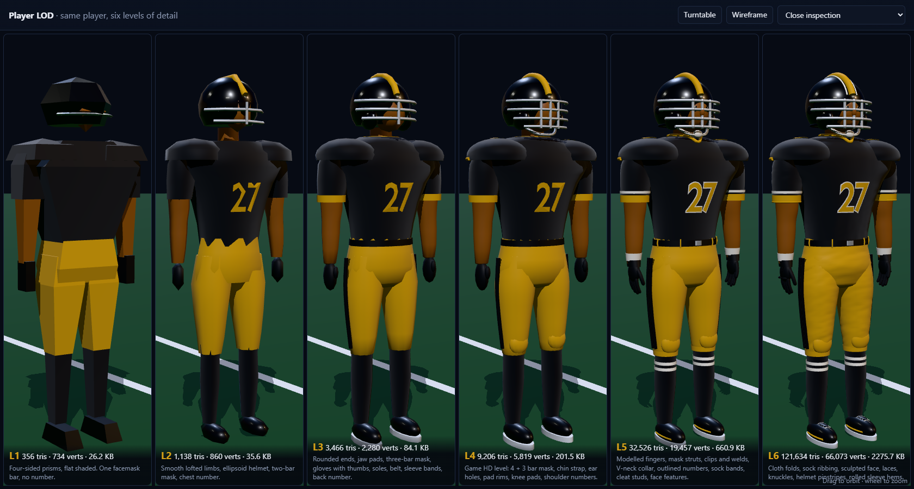
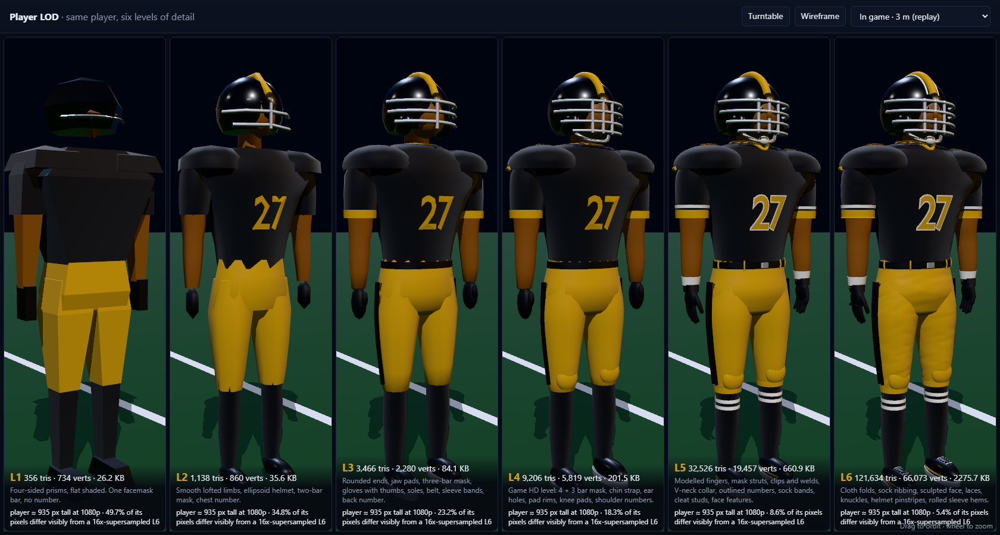
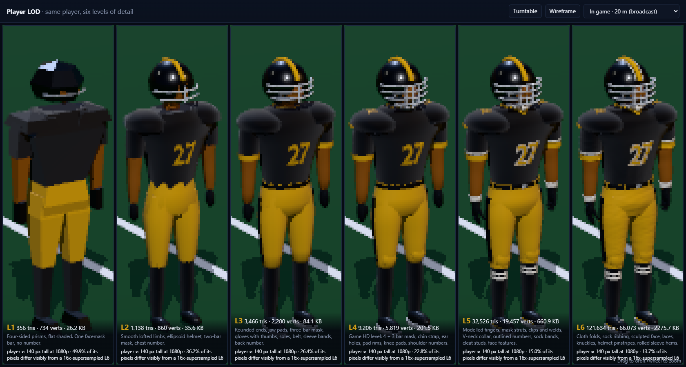
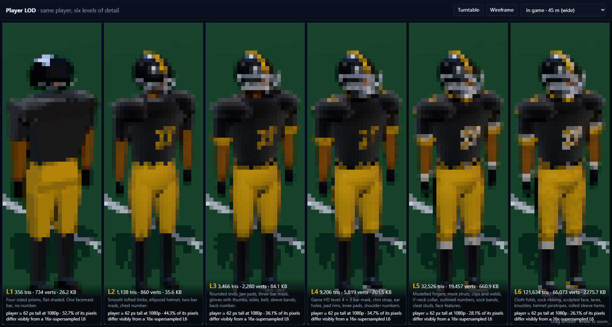
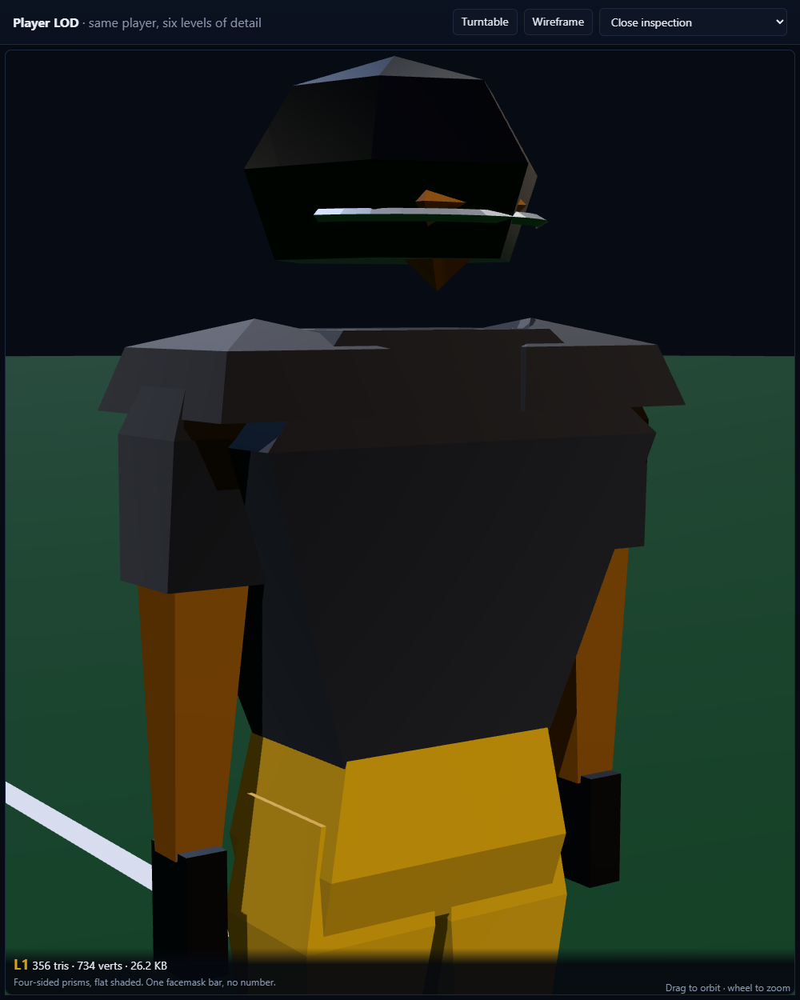
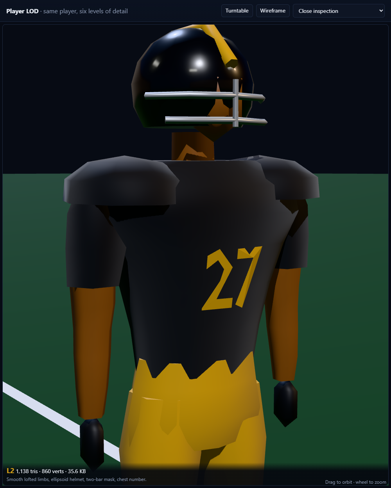
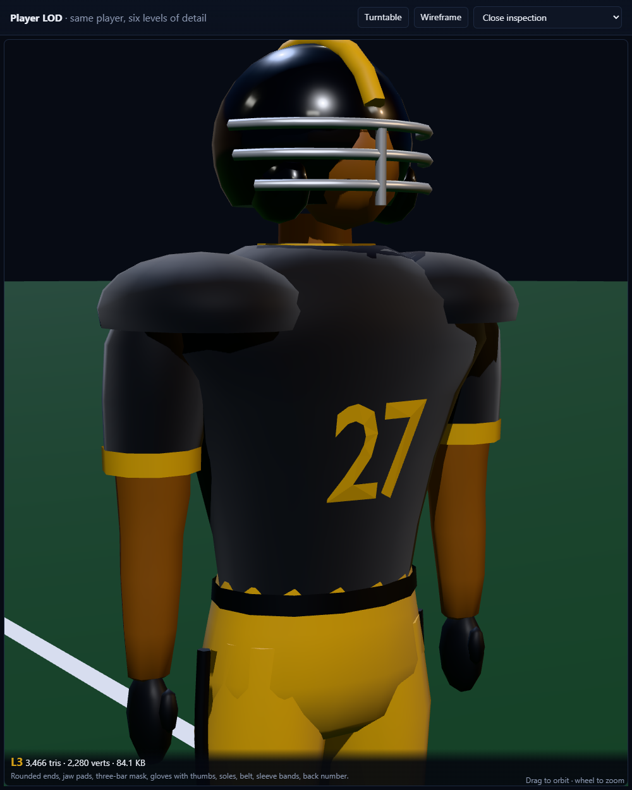
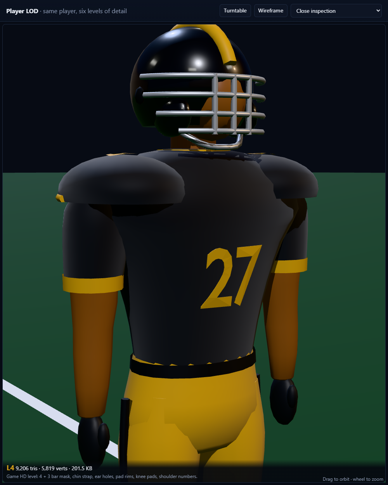
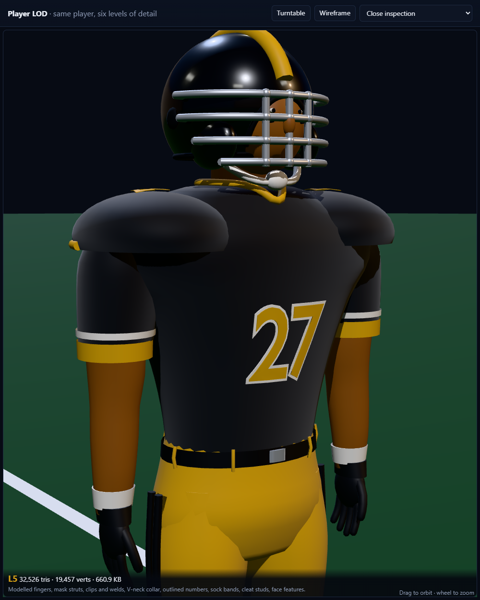
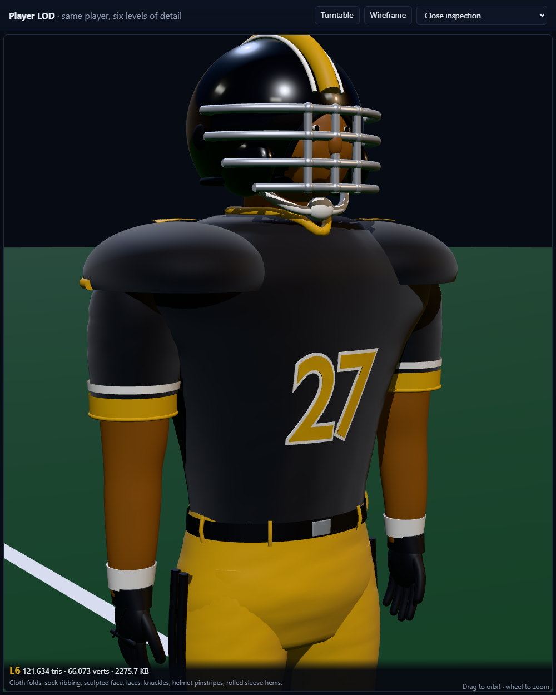

# Player LOD showcase

One Friday Night Spa City player in the Hot Springs home uniform, built six times in Blender at six levels of detail (LOD).
The levels run from 356 to 121,634 triangles and are shown side by side in three.js under one night-stadium light rig.
The question: **where do extra triangles stop paying for themselves?**



| | Triangles | glTF vertices | GLB size | Draw calls | What this level adds |
|---|---:|---:|---:|---:|---|
| **L1** | 356 | 734 | 26.2 KB | 8 | Every round part is a flat-shaded four-sided prism. The helmet is a six-sided lump with one facemask bar. No number. |
| **L2** | 1,138 | 860 | 35.6 KB | 10 | Smooth lofted limbs (about 7 sides), an ellipsoid helmet with a centre stripe, a two-bar mask, and the chest number as real geometry. |
| **L3** | 3,466 | 2,280 | 84.1 KB | 12 | Domed ends, jaw pads, a three-bar mask, mitten gloves with thumbs, cleat soles, a belt, sleeve bands, a pant stripe, a collar and the back number. |
| **L4** | 9,206 | 5,819 | 201.5 KB | 13 | The game's HD level (`build_hd.py` is about 11k): a 4 + 3 bar mask, chin strap, ear holes, shoulder-pad rims, knee pads and shoulder "TV" numbers. |
| **L5** | 32,526 | 19,457 | 660.9 KB | 17 | Modelled fingers and thumb; mask struts, mounting clips and welds; rubber rims on the helmet edge and face opening; a chin cup; a V-neck collar laid on the jersey surface; outlined numbers; double pant stripes; sock bands; wristbands; cleat studs and side trim; a belt buckle and loops; nose, eyes and eye black. |
| **L6** | 121,634 | 66,073 | 2,275.7 KB | 17 | Sculpt-style displacement: cloth folds on the jersey, sleeves and pants, sock ribbing, and a sculpted face (cheekbones, brow, eye sockets, chin). Also laces and a tongue, glove knuckles and seams, helmet pinstripes, rolled sleeve hems and lips. |

The triangle and vertex counts come from the GLB files themselves: index count ÷ 3, and the `POSITION` accessor counts. three.js reports the same triangle counts after loading, as `sceneTris` in `shots/metrics.json`. Sizes are plain, uncompressed glTF: float32 positions and normals, no UVs or textures, and PBR materials. Clearcoat is used on the helmet and cleats, a faint sheen on the fabric. Each level is one mesh with one primitive per material.

**Where the triangles go at L6:** body 47k, helmet 19k, facemask 14k, trim 14k, feet 9k, hands 8k, face 5k and numbers 5k. Per-level breakdowns are in `models/stats.json`.

## Where the gains flatten out

The **In game** modes render each level at the pixel size it would really get on a 1080p screen. They use the game's 40° camera at 3, 8, 20 and 45 m. The pixels are then magnified so you can see them.

Each level is compared to a **16×-supersampled L6**: L6 rendered 4 × 4 larger and box-filtered down, which is about as good as that pixel count can look. The table shows the share of the player's pixels that differ visibly from it (any channel off by more than 12/255).

| Distance (player height on screen) | L1 | L2 | L3 | L4 | L5 | L6 |
|---|---:|---:|---:|---:|---:|---:|
| 3 m, replay (≈ 935 px) | 49.7 % | 34.8 % | 23.2 % | 18.3 % | 8.6 % | 5.4 % |
| 8 m, behind the play (≈ 351 px) | 51.2 % | 33.8 % | 23.3 % | 19.2 % | 9.6 % | 7.5 % |
| 20 m, broadcast (≈ 140 px) | 49.9 % | 36.2 % | 26.4 % | 22.8 % | 15.0 % | 13.7 % |
| 45 m, wide (≈ 62 px) | 52.7 % | 44.3 % | 36.1 % | 34.7 % | 28.1 % | 26.1 % |

The L6 column is the floor. It is L6 against a better-sampled version of itself, so it is pure aliasing, and no triangle count can beat it. Read each level as its distance above that floor:

- **L5 → L6 (×3.7 triangles, ×3.4 file size) only pays in close-ups.** At 3 m L5 is 3.2 points above the floor. From 8 m out it is about 2 points, and at 20 m 1.3 points: the folds, laces and knuckles are smaller than a pixel. A 3.4× larger file buys nothing at broadcast distance.
- **L4 → L5 still shows at every distance, but because of parts, not density.** L4 stays 8.6–12.9 points above the floor even at 45 m. Most of what L5 adds is colour blocking big enough to survive a 62 px player: white sock bands, wristbands, white number outlines and double stripes. That reading comes from the shots below; the tessellation alone wasn't isolated. **Takeaway: spend the budget on silhouette and colour regions, not smoothness.**
- **L1 → L3 is where most of the visible quality comes from:** the first 3.5k triangles remove 17–27 points of error, depending on distance. L1 stays about 50 % off everywhere, because a boxy silhouette is wrong at any size.
- **At a distance, sampling matters more than triangles.** The floor itself climbs from 5 % at 3 m to 26 % at 45 m. A wide shot gains more from better anti-aliasing (TAA, supersampling) than from more geometry.

In practice for the game: about L4 (9k) for the broadcast camera, L5 (33k) only for replays and close cameras, L3 (3.5k) for the far side of the field. With 22 players on screen, L6 would mean about 2.7 M triangles for detail nobody can see at 20 m.

| 3 m | 20 m | 45 m |
|---|---|---|
|  |  |  |

## Close-ups (front three-quarter)

| L1 | L2 | L3 |
|---|---|---|
|  |  |  |
| **L4** | **L5** | **L6** |
|  |  |  |

Wireframe: [shots/row-wire.png](shots/row-wire.png).

## Highest-quality reference

The L6 target was set against a commercial model the user picked: [American Football Player by Trish on RenderHub](https://www.renderhub.com/trish/american-football-player-1). It is a $60 mid-poly model with 54,515 polygons and 56,384 vertices, textured, with facial blend shapes. **It was not bought or downloaded.** Only its public preview renders were viewed, as a visual target.

Its polygons are likely mostly quads, which puts it at roughly 109k triangles. L6 has the same budget (121,634 triangles, 66,073 vertices).

The reference spends that budget differently:

- It has sculpted anatomy and a full head, and gets its fabric mesh, numbers and logos from photo textures.
- L6 is untextured, so every detail here is geometry: the numbers, folds, stripes and laces.

The cues taken from it are the double pant stripes, banded socks, laced cleats, a sculpted face and the overall budget. The uniform stays in Hot Springs colours.

## How it's built

`build_lods.py` (Blender 5.2, headless) builds all six levels from **the same control data**: the rings, paths and colour slots of `art-src/blender/players/build_hd.py`. It uses metre scale, the same rest pose and front = −Y, and exports with +Y up, so the player faces +Z in three.js.

Each level differs in two ways:

1. **Tessellation:** loft rings and tube paths are resampled with Catmull-Rom splines at a per-level density (sides per part, rings per metre, dome rings on rounded ends). The silhouette is the same curve at every level, only sampled more finely, so the proportions never drift.
2. **Parts:** each level adds geometry the level below can't afford (see the first table).

The numbers are Blender's built-in font converted to mesh. They are projected onto the actual chest, back and shoulder-pad surfaces with a BVH ray cast, so at L6 they follow the cloth folds. The folds are ridged Perlin noise displaced along the normals, made coarser than the mesh spacing so they read as creases rather than noise.

Colours come from the game's home uniform (`uniformFor` in `src/js/players3d.js`): jersey and helmet `#111111`; trim, pants and number fill `#D4A017` with a `#F4EFE6` outline. The brief called the trim orange; the game data has this gold, and it is one constant in `COL` if orange is wanted. The facemask is light grey, `#D9DCE0`. The pant stripes are black so they show on gold pants.

## Run it

```bash
"C:\Program Files\Blender Foundation\Blender 5.2\blender.exe" -b --factory-startup --python experiments/lod-showcase/build_lods.py
```

The build rebuilds `models/L1.glb` … `models/L6.glb` and `models/stats.json` in about 6 s. Append `-- 2 5` to build only some levels.

```bash
node experiments/lod-showcase/serve.mjs
```

Then open <http://127.0.0.1:8765/experiments/lod-showcase/>. The GLBs can't be fetched from `file://`, so the page needs this tiny static server. It serves the game root so the page can import the vendored three.js r186.

Controls:

- drag to orbit (all six views move together); wheel to zoom;
- **Turntable**, **Wireframe**, and the distance menu (close inspection, or in-game 3 / 8 / 20 / 45 m with the live pixel comparison).
- URL options: `?solo=3` shows one level full size, `?still` stops the turntable, `?game=2` opens at 20 m.

```bash
node experiments/lod-showcase/shots.mjs
```

The shot script regenerates `shots/` and `shots/metrics.json` on the real GPU: installed Chrome, `--enable-gpu --use-angle=d3d11`, Playwright from `shared/test-harness`. Captured on an NVIDIA GeForce RTX 5060 via ANGLE/D3D11. It fails if the renderer is SwiftShader or the page logs errors.

Lighting:

- a cool key directional light with a 4096² shadow map;
- a warm fill from the "stands" and a cool rim from a second light tower;
- a hemisphere light;
- a PMREM environment baked from a small HDR scene: dark sky, four light banks, stands, field.

Tone mapping is Khronos PBR Neutral, so the team colours stay true; ACES bleached the gold.
